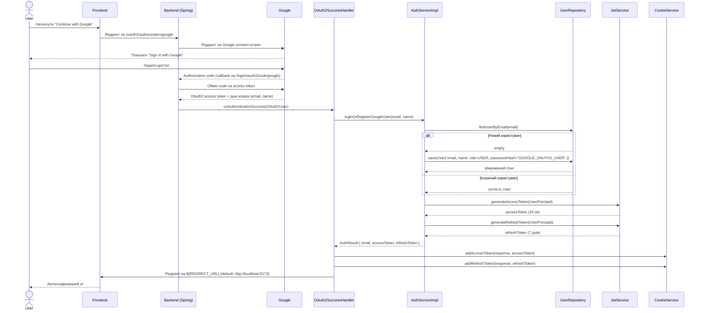

# Google OAuth 2.0

## Огляд

Автентифікація через Google-акаунт з використанням Spring Security OAuth2 Client. Якщо користувач логіниться вперше — він автоматично реєструється. При наступних логінах — просто автентифікується.

## Flow



## Як це працює

### 1. Фронтенд запускає флоу

```js
window.location.href = 'http://localhost:8081/oauth2/authorization/google'
```

Це не звичайний API-виклик — це повний редірект браузера. Spring Security перехоплює цей URL і далі обробляє все сам.

### 2. Spring будує URL авторизації Google

Spring автоматично формує і виконує редірект на:

```
https://accounts.google.com/o/oauth2/auth
  ?client_id=...
  &redirect_uri=http://localhost:8081/login/oauth2/code/google
  &scope=email profile
  &response_type=code
  &state=<випадковий рядок>
```

Браузер відкриває сторінку "Sign in with Google". Backend на цьому етапі нічого не робить — він лише чекає на callback.

### 3. Користувач надає дозвіл у Google

Google показує consent screen: "Verdora wants access to your email and profile". Користувач натискає "Allow".

### 4. Google надсилає authorization code назад

```
GET http://localhost:8081/login/oauth2/code/google
  ?code=4/P7q7W91...
  &state=<випадковий рядок>
```

`code` — одноразовий Authorization Code. Сам по собі він безкорисний — його потрібно обміняти на токен.

### 5. Spring обмінює code на дані користувача

Spring автоматично робить POST-запит до token endpoint Google, отримує `access_token`, а потім викликає:

```
GET https://www.googleapis.com/oauth2/v2/userinfo
```

Google повертає:
```json
{ "email": "user@gmail.com", "name": "Stepan Kovalenko", "picture": "..." }
```

**Все це виконує Spring Security автоматично** — жодного рядка цього коду не написано вручну.

### 6. `OAuth2SuccessHandler` — звідки починається наш код

```java
OAuth2User oauthUser = (OAuth2User) authentication.getPrincipal();
String email = oauthUser.getAttribute("email");
String name = oauthUser.getAttribute("name");

AuthResult result = authService.loginOrRegisterGoogleUser(email, name);
```

Spring викликає цей handler після успішної Google-автентифікації, передаючи дані користувача через `OAuth2User`.

### 7. Upsert-логіка — `loginOrRegisterGoogleUser`

```java
User user = userRepository.findUserByEmail(email)
    .orElseGet(() -> {
        User newUser = new User();
        newUser.setEmail(email);
        newUser.setName(name);
        newUser.setRole(Role.USER);
        newUser.setPasswordHash("GOOGLE_OAUTH2_USER"); // плейсхолдер
        return userRepository.save(newUser);
    });
```

Один метод обробляє два сценарії:

- **Перший логін** — користувача не існує → створити і зберегти. `passwordHash = "GOOGLE_OAUTH2_USER"` — плейсхолдер, який ніколи не використовується для логіну через email/пароль.
- **Повторний логін** — користувач уже існує → просто завантажити його. Нічого не оновлюється (ім'я з Google-акаунту не синхронізується повторно).

Після цього `accessToken` і `refreshToken` генеруються точно так само, як при звичайному Sign In.

### 8. Cookies і редірект

```java
cookieService.addAccessToken(response, result.accessToken());
cookieService.addRefreshToken(response, result.refreshToken());
response.sendRedirect(oAuth2Properties.getRedirectUri()); // http://localhost:5173
```

Браузер отримує cookies і перенаправляється на фронтенд — користувач тепер автентифікований. `accessToken` живе в браузері 1 годину, але сам JWT валідний **15 хвилин** (як і при звичайному логіні — див. [JWT](./jwt.md)).

### Чому OAuth2 потребує сесію

```java
.sessionManagement(session -> session
    .sessionCreationPolicy(SessionCreationPolicy.IF_REQUIRED))
```

На відміну від JWT-флоу, де сесія не потрібна, OAuth2 **тимчасово** використовує сесію, щоб зберігати параметр `state` між кроками (редірект на Google → callback від Google). Це запобігає CSRF-атакам під час OAuth-флоу. Після завершення автентифікації сесія більше не використовується.

## Конфігурація

**`application.yaml`**

```yaml
spring:
  security:
    oauth2:
      client:
        registration:
          google:
            client-id: ${GOOGLE_CLIENT_ID}
            client-secret: ${GOOGLE_CLIENT_SECRET}
            scope: [ email, profile ]

app:
  oauth2:
    redirect-uri: ${REDIRECT_URL:http://localhost:5173}
```

**`.env`**

```env
GOOGLE_CLIENT_ID=your_client_id
GOOGLE_CLIENT_SECRET=your_client_secret
REDIRECT_URL=http://localhost:5173
```

## Ключові компоненти

### `OAuth2SuccessHandler`

Викликається Spring Security після успішної авторизації через Google. Дістає `email` і `name` з `OAuth2User`, делегує бізнес-логіку `AuthService`, встановлює cookies і робить редірект на фронтенд.

### `AuthServiceImpl#loginOrRegisterGoogleUser`

```java
User user = userRepository.findUserByEmail(email)
    .orElseGet(() -> {
        User newUser = new User();
        newUser.setEmail(email);
        newUser.setName(name);
        newUser.setRole(Role.USER);
        newUser.setPasswordHash("GOOGLE_OAUTH2_USER"); // плейсхолдер
        return userRepository.save(newUser);
    });
```

Upsert-логіка: знайти або створити — один метод обробляє обидва сценарії.

### `SecurityConfig`

```java
.oauth2Login(oauth2 -> oauth2
    .successHandler(oAuth2SuccessHandler)
)
```

Публічні маршрути для OAuth2-флоу:

```java
.requestMatchers("/oauth2/**", "/login/oauth2/**").permitAll()
```

## Отримання Client ID і Secret

1. Відкрити [Google Cloud Console](https://console.cloud.google.com/)
2. Створити проєкт → **APIs & Services** → **Credentials**
3. **Create Credentials** → **OAuth 2.0 Client IDs**
4. Тип застосунку: **Web application**
5. Authorized redirect URIs:
   ```
   http://localhost:8081/login/oauth2/code/google
   ```
6. Скопіювати `Client ID` і `Client Secret` у `.env`
