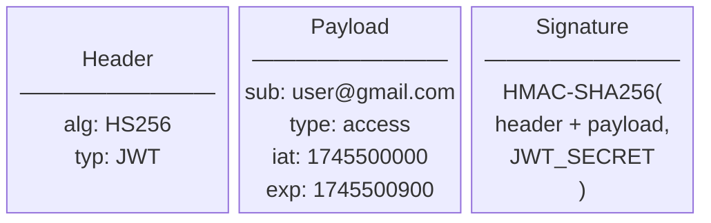
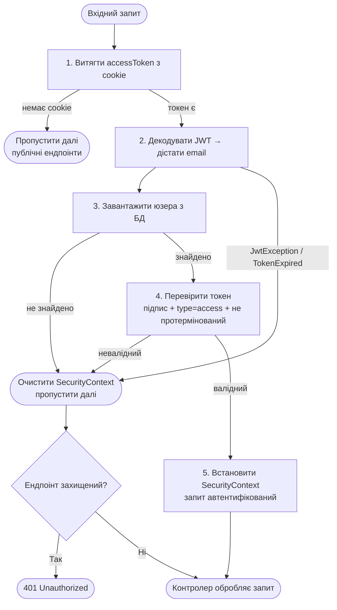
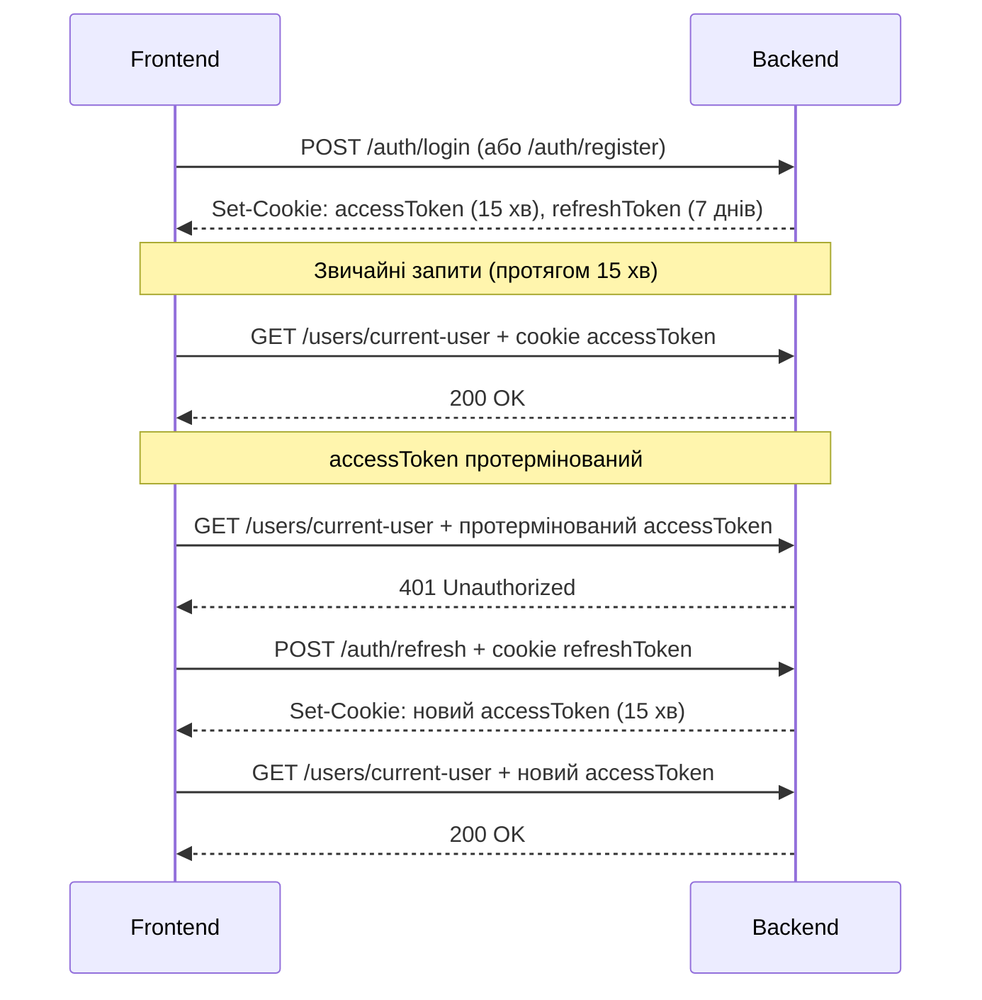

# JWT — JSON Web Token

## Що таке JWT

JWT (JSON Web Token) — відкритий стандарт для безпечної передачі інформації між сторонами у вигляді компактного самодостатнього рядка. Ключова властивість: сервер **не зберігає** токени ніде. Весь необхідний для перевірки вміст закладений у самому токені — сервер лише перевіряє підпис на кожному запиті.

---

## Структура токена

JWT складається з трьох частин, розділених крапками:

```
header.payload.signature
```

Реальний приклад:
```
eyJhbGciOiJIUzI1NiJ9.eyJzdWIiOiJ1c2VyQGdtYWlsLmNvbSIsInR5cGUiOiJhY2Nlc3MiLCJpYXQiOjE3NDU1MDAwMDAsImV4cCI6MTc0NTUwMDkwMH0.abc123...
```

Кожна частина закодована у Base64URL — **не зашифрована**, лише закодована. Будь-хто може декодувати header і payload. Безпеку забезпечує саме підпис.



### Header

```json
{
  "alg": "HS256",
  "typ": "JWT"
}
```

Описує алгоритм підпису. `HS256` = HMAC + SHA-256.

### Payload (Claims)

```json
{
  "sub": "user@gmail.com",
  "type": "access",
  "iat": 1745500000,
  "exp": 1745500900
}
```

| Поле | Назва | Опис |
|---|---|---|
| `sub` | Subject | Кому належить токен — у цьому проєкті: email |
| `type` | Кастомний claim | `"access"` або `"refresh"` — розрізняє типи токенів |
| `iat` | Issued At | Unix timestamp видачі токена |
| `exp` | Expiration | Unix timestamp закінчення дії |

### Signature

```
HMAC-SHA256(
  base64url(header) + "." + base64url(payload),
  secret
)
```

Підпис обчислюється за допомогою секретного ключа (`JWT_SECRET`). Якщо хтось підмінить payload — навіть один символ — підпис стане невалідним, і токен буде відхилено.

---

## Як це працює в проєкті

### Генерація токена — `JwtService`

```java
public String generateAccessToken(UserDetails userDetails) {
    return Jwts.builder()
            .setSubject(userDetails.getUsername())   // email
            .claim("type", "access")
            .setIssuedAt(new Date())
            .setExpiration(new Date(System.currentTimeMillis() + jwtProperties.getAccessExpirationMs()))
            .signWith(getSecretKey())
            .compact();
}

private SecretKey getSecretKey() {
    return Keys.hmacShaKeyFor(jwtProperties.getSecret().getBytes(StandardCharsets.UTF_8));
}
```

Секретний ключ завантажується зі значення `JWT_SECRET` з `.env` через `JwtProperties` (`@ConfigurationProperties(prefix = "app.jwt")`). Токен підписується HMAC-SHA і повертається як компактний рядок.

### Два типи токенів

| | `accessToken` | `refreshToken` |
|---|---|---|
| Claim `type` | `"access"` | `"refresh"` |
| Термін дії токена | 15 хвилин (`app.jwt.access-expiration-ms`) | 7 днів (`app.jwt.refresh-expiration-ms`) |
| Призначення | Авторизує API-запити | Видає новий `accessToken` |
| Path cookie | `/` | `/auth/refresh` |

Claim `type` не дозволяє використати `refreshToken` замість `accessToken` і навпаки — це явно перевіряється у `isAccessTokenValid` та `isRefreshTokenValid`.

### Зберігання — `CookieService`

Токени зберігаються в `HttpOnly` cookies, а не в `localStorage` чи пам'яті:

```java
public void addAccessToken(HttpServletResponse response, String token) {
    ResponseCookie cookie = ResponseCookie.from("accessToken", token)
            .httpOnly(true)   // JavaScript не може прочитати цей cookie — захист від XSS
            .secure(true)     // лише через HTTPS
            .sameSite("None") // дозволяє cross-site запити з фронтенду на іншому домені
            .path("/")
            .maxAge(60 * 60)  // 1 година життя cookie в браузері; сам токен валідний лише 15 хв
            .build();

    response.addHeader(HttpHeaders.SET_COOKIE, cookie.toString());
}
```

`refreshToken` має обмежений path:
```java
.path("/auth/refresh")
```
Це означає, що браузер надсилає `refreshToken` лише при зверненні до `/auth/refresh` — він не подорожує з кожним запитом.

> **Важливо:** cookie `accessToken` живе в браузері 1 годину (`maxAge`), але сам JWT-токен валідний лише **15 хвилин** (`exp`-claim). Після 15 хвилин cookie ще існує, але сервер відхилить токен як протермінований (`TokenExpiredException` → 401) — саме тому потрібен `POST /auth/refresh`.

### Валідація кожного запиту — `JwtAuthenticationFilter`

Цей фільтр виконується на кожному вхідному запиті, перш ніж він дістанеться контролера:

```java
String token = extractTokenFromCookies(request);   // 1. прочитати accessToken з cookie
if (token == null) {
    filterChain.doFilter(request, response);         // токена немає — пропустити далі (публічні ендпоінти)
    return;
}

try {
    String email = jwtService.extractUsername(token);   // 2. декодувати JWT, дістати email з "sub"

    if (email != null && SecurityContextHolder.getContext().getAuthentication() == null) {
        UserDetails userDetails = userDetailsService.loadUserByUsername(email); // 3. завантажити юзера з БД
        if (jwtService.isAccessTokenValid(token, userDetails)) {                // 4. перевірити токен
            UsernamePasswordAuthenticationToken authToken = new UsernamePasswordAuthenticationToken(
                userDetails, null, userDetails.getAuthorities()
            );
            SecurityContextHolder.getContext().setAuthentication(authToken);    // 5. позначити як автентифікованого
        }
    }
} catch (InvalidTokenException | TokenExpiredException | JwtException
         | IllegalArgumentException | AuthenticationException exception) {
    SecurityContextHolder.clearContext();             // невалідний/протермінований токен — просто не автентифікуємо
}
filterChain.doFilter(request, response);             // 6. передати далі до контролера
```

Якщо токен невалідний або протермінований, фільтр **не кидає виняток назовні** — він просто очищає `SecurityContext` і пропускає запит далі без автентифікації. Остаточне рішення "потрібна авторизація чи ні" ухвалює Spring Security на етапі `authorizeHttpRequests` (`SecurityConfig`): для захищених шляхів неавторизований запит завершується кастомним `authenticationEntryPoint` з відповіддю `401 {"status":401,"message":"Unauthorized","data":null}`.



Крок за кроком:
1. Витягти `accessToken` з cookies
2. Декодувати JWT і отримати email з claim `sub`
3. Завантажити користувача з бази даних (перевіряє, що він ще існує)
4. Перевірити валідність підпису токена і що `type` дорівнює `"access"`
5. Встановити автентифікацію в `SecurityContext` — Spring Security тепер знає, хто робить запит
6. Передати далі наступному фільтру / контролеру

### Валідація токена — `isAccessTokenValid`

```java
public boolean isAccessTokenValid(String token, UserDetails userDetails) {
    Claims claims = extractAllClaims(token); // кидає TokenExpiredException або InvalidTokenException
    return userDetails.getUsername().equals(claims.getSubject())
            && "access".equals(claims.get("type", String.class));
}
```

`extractAllClaims` використовує секретний ключ, щоб розпарсити і перевірити підпис. Якщо токен протермінований — `ExpiredJwtException` перехоплюється і перекидається як `TokenExpiredException`. Якщо токен підроблений — `JwtException` → `InvalidTokenException`.

---

## Флоу оновлення токена (Refresh)

Коли `accessToken` протерміновується (через 15 хвилин), фронтенд викликає `POST /auth/refresh`. Cookie `refreshToken` надсилається автоматично:

```java
public String refresh(String refreshToken) {
    if (refreshToken == null) throw new InvalidTokenException();
    if (!jwtService.isRefreshToken(refreshToken)) throw new WrongTokenTypeException();  // перевірка типу

    String email = jwtService.extractUsername(refreshToken);
    UserDetails userDetails = userDetailsService.loadUserByUsername(email);

    if (!jwtService.isRefreshTokenValid(refreshToken, userDetails)) throw new InvalidTokenException();

    return jwtService.generateAccessToken(userDetails);  // новий accessToken, той самий refreshToken
}
```



`refreshToken` не ротується — той самий токен використовується повторно, поки не протермінується (7 днів). У продакшн-середовищі це варто враховувати як питання безпеки (ротація refresh-токенів наразі не реалізована).

---

## Stateless vs Stateful

Традиційна сесійна автентифікація зберігає дані сесії на сервері, а клієнту віддає лише ID сесії. JWT — stateless: сервер нічого не зберігає. Кожен токен самодостатній.

| | Сесійна автентифікація | JWT (цей проєкт) |
|---|---|---|
| Сервер зберігає | Сесію в БД/пам'яті | Нічого |
| Токен містить | Лише ID | Усі дані + підпис |
| Відкликання (revocation) | Видалити сесію з БД | Неможливе без blocklist |
| Масштабування | Потрібне спільне сховище сесій | Працює на кількох інстансах без змін |

Компроміс: оскільки токени stateless, їх **неможливо відкликати** до закінчення терміну дії. Якщо `accessToken` скомпрометовано, він залишається валідним до 15 хвилин. Саме тому короткий термін дії важливий.

---

## Конфігурація

```yaml
app:
  jwt:
    secret: ${JWT_SECRET:3qzqVSvMGFVncul6arlN0Na0F/YcSbmJyvICg43Q2cQ=}
    access-expiration-ms: 900000     # 15 хв
    refresh-expiration-ms: 604800000 # 7 днів
```

Прив'язується до `JwtProperties` через `@ConfigurationProperties(prefix = "app.jwt")`.

Секрет повинен містити щонайменше 256 бітів (32 символи) для HMAC-SHA256. Для продакшну згенеруйте новий:

```bash
openssl rand -base64 32
```

> У `application.yaml` для `JWT_SECRET` заданий дефолт-значення для локальної розробки — у продакшн-середовищі змінну середовища `JWT_SECRET` слід обов'язково перевизначити власним секретом.

---

## Огляд компонентів

| Клас | Роль |
|---|---|
| `JwtService` | Генерує і валідує токени |
| `JwtProperties` | Прив'язує конфігураційні властивості `app.jwt.*` |
| `JwtAuthenticationFilter` | Перехоплює кожен запит, валідує `accessToken` |
| `CookieService` | Встановлює, читає і очищає `HttpOnly` cookies |
| `UserPrincipal` | Обгортає сутність `User`, реалізує `UserDetails` |
