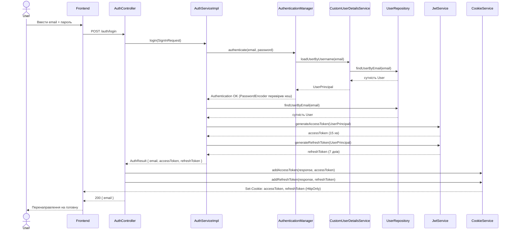

# Sign In

## Огляд

Стандартна автентифікація за email та паролем. Після успішного логіну встановлюються два `HttpOnly` cookies — `accessToken` і `refreshToken`.

## Ендпоінт

```
POST /auth/login
Content-Type: application/json
```

### Тіло запиту

```json
{
  "email": "user@gmail.com",
  "password": "12345678"
}
```

`SignInRequest` валідується анотаціями `@NotBlank` на обох полях і `@Email` на `email`.

### Успішна відповідь `200`

```json
{
  "timestamp": "2026-04-21T13:55:49.772Z",
  "status": 200,
  "message": "Login successful",
  "data": {
    "email": "user@gmail.com"
  }
}
```

Cookies, що встановлюються автоматично:

| Cookie | HttpOnly | Secure | SameSite | Path | Max-Age cookie / термін дії JWT |
|---|---|---|---|---|---|
| `accessToken` | ✅ | ✅ | None | `/` | 1 година / **15 хвилин** |
| `refreshToken` | ✅ | ✅ | None | `/auth/refresh` | 7 днів / 7 днів |

### Помилка `401`

```json
{
  "timestamp": "2026-04-21T13:55:49.773Z",
  "status": 401,
  "message": "Invalid email or password",
  "data": null
}
```

## Flow



## Як це працює

### 1. Запит потрапляє в `AuthController`

Запит досягає `AuthController.login()`, який одразу делегує роботу `AuthService.login(request)`. На відміну від `/auth/register`, тут **немає анотації `@Valid`** на рівні контролера — формальна валідація email/пароля (крім `@NotBlank`/`@Email` у самому DTO) тут не відбувається додатково; невідповідність облікових даних обробляється на рівні автентифікації.

### 2. `AuthenticationManager` — ядро флоу (`AuthServiceImpl.login`)

```java
authenticationManager.authenticate(
    new UsernamePasswordAuthenticationToken(request.email(), request.password())
);
```

Цей один рядок запускає повний внутрішній ланцюжок:

`AuthenticationManager` → делегує `DaoAuthenticationProvider` → викликає `CustomUserDetailsService.loadUserByUsername(email)` → завантажує користувача з бази даних і повертає `UserPrincipal` → `DaoAuthenticationProvider` бере `getPassword()` з `UserPrincipal` (BCrypt-хеш) і через `PasswordEncoder.matches(rawPassword, hash)` порівнює його з вхідним паролем.

Якщо пароль не збігається — кидається `BadCredentialsException`, його перехоплює `GlobalExceptionHandler`, і повертається `401`.

### 3. Повторний запит до бази даних

```java
User user = userRepository.findUserByEmail(request.email())
        .orElseThrow(InvalidCredentialsException::new);
```

Хоча `CustomUserDetailsService` вже завантажував користувача під час автентифікації, цей результат тут повторно не використовується. `AuthenticationManager.authenticate()` повертає об'єкт `Authentication`, який не зберігається, тому `User` завантажується ще раз, щоб побудувати `UserPrincipal` для генерації токенів.

### 4. Генерація JWT-токенів

```java
UserPrincipal principal = new UserPrincipal(user);
String accessToken = jwtService.generateAccessToken(principal);
String refreshToken = jwtService.generateRefreshToken(principal);
```

Кожен токен — підписаний JWT з таким payload:

```json
{
  "sub": "user@gmail.com",
  "type": "access | refresh",
  "iat": "<момент видачі>",
  "exp": "<момент закінчення>"
}
```

Підписується HMAC-SHA з ключем `JWT_SECRET`.

### 5. Cookies (`AuthController`)

Після повернення `AuthResult` з `AuthServiceImpl`, саме `AuthController` встановлює два `HttpOnly` cookies через `CookieService`:

- **`accessToken`** — path `/`, живе 1 годину в браузері, сам JWT валідний **15 хвилин**. Надсилається автоматично з кожним запитом до backend.
- **`refreshToken`** — path `/auth/refresh`, 7 днів. Надсилається лише коли фронтенд явно звертається до `/auth/refresh`, а не з кожним запитом.

`HttpOnly` означає, що JavaScript не може прочитати ці cookies — захист від XSS-атак. Обидва cookies також мають `secure(true)` і `sameSite("None")` (`CookieService`), тобто працюють лише через HTTPS і дозволяють cross-site запити з фронтенду на іншому домені.

### 6. Як токен захищає подальші запити — `JwtAuthenticationFilter`

Після логіну кожен запит до захищеного ендпоінту проходить через цей фільтр:

```java
String token = extractTokenFromCookies(request);              // зчитує accessToken з cookie
String email = jwtService.extractUsername(token);              // декодує JWT, дістає email
UserDetails userDetails = userDetailsService.loadUserByUsername(email); // звернення до БД
if (jwtService.isAccessTokenValid(token, userDetails)) {
    SecurityContextHolder.getContext().setAuthentication(...);  // позначає запит як автентифікований
}
```

На кожному запиті: JWT декодується, користувач завантажується з бази, і перевіряються тип токена (`"access"`) та підпис. Лише після цього Spring Security дозволяє запиту дістатися захищеного ендпоінту. Детальніше — у [JWT](./jwt.md).

## Оновлення токена (Refresh)

Коли `accessToken` протерміновується, фронтенд викликає:

```
POST /auth/refresh
```

`refreshToken` надсилається автоматично через cookie. Backend перевіряє його тип (`"type": "refresh"`), дістає email і видає новий `accessToken`.

## Logout

```
POST /auth/logout
```

Обидва cookies очищаються (`Max-Age = 0`), а також очищається `JSESSIONID` (сесія OAuth2, якщо вона була створена).
