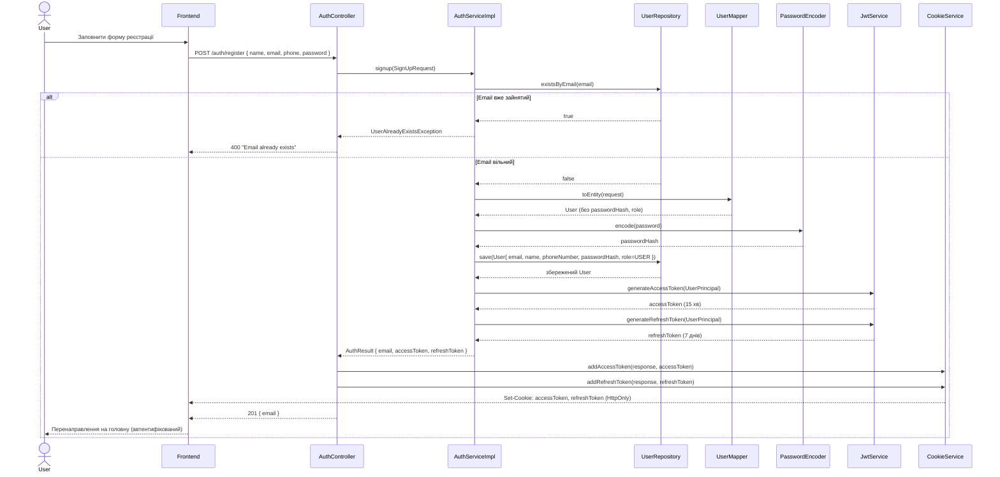

# Sign Up

## Огляд

Реєструє нового користувача. Після успішної реєстрації користувач одразу автентифікований — встановлюються cookies `accessToken` і `refreshToken`, тож окремий крок логіну не потрібен.

## Ендпоінт

```
POST /auth/register
Content-Type: application/json
```

### Тіло запиту

```json
{
  "name": "Stepan",
  "email": "user@gmail.com",
  "phone": "+380989703417",
  "password": "StrongPass1!"
}
```

| Поле | Обов'язкове | Валідація (`SignUpRequest`) |
|---|---|---|
| `name` | ✅ | не порожнє, мінімум 2 символи |
| `email` | ✅ | коректний формат email |
| `phone` | ❌ | без явної валідації формату на рівні DTO (поле опціональне) |
| `password` | ✅ | 8–20 символів; має містити хоча б одну велику літеру, одну малу, одну цифру і один спецсимвол із `!@#$%` |

> У сутності `User` поле `phoneNumber` має власний `@Pattern` (`^$|^\+?[0-9]{7,15}$`), але ця перевірка спрацьовує лише при збереженні через Hibernate bean-validation, а не як контрольована `400`-відповідь від контролера — тобто помилка формату телефону на цьому етапі не гарантовано повертає чистий `400 Bad Request`.

### Успішна відповідь `201`

```json
{
  "timestamp": "2026-04-21T13:55:49.772Z",
  "status": 201,
  "message": "User created",
  "data": {
    "email": "user@gmail.com"
  }
}
```

Cookies, що встановлюються автоматично:

| Cookie | HttpOnly | Secure | SameSite | Path | Max-Age cookie / термін дії JWT |
|---|---|---|---|---|---|
| `accessToken` | ✅ | ✅ | None | `/` | 1 година / **15 хвилин** |
| `refreshToken` | ✅ | ✅ | None | `/auth/refresh` | 7 днів / 7 днів |

### Помилка `400`

```json
{
  "timestamp": "2026-04-21T13:55:49.773Z",
  "status": 400,
  "message": "Email already exists",
  "data": null
}
```

## Flow



## Як це працює

### 1. Валідація на рівні контролера

```java
@PostMapping("/register")
public ResponseEntity<...> signup(@Valid @RequestBody SignUpRequest request, ...)
```

`@Valid` запускає Spring bean-валідацію ще до виконання тіла методу. Якщо `password` коротший за 8 символів, не відповідає шаблону складності, або `email` має невалідний формат — Spring одразу повертає `400`, не заходячи в метод.

### 2. Перевірка дубліката email

```java
if (userRepository.existsByEmail(request.email())) {
    throw new UserAlreadyExistsException();
}
```

Один запит до бази даних, щоб перевірити, чи email вже зайнятий. Якщо так — кидається виняток, його перехоплює `GlobalExceptionHandler`, і повертається `400`. Ця перевірка відбувається першою, щоб уникнути зайвої роботи.

### 3. Мапінг запиту в сутність

```java
User user = userMapper.toEntity(request);
```

`UserMapper` (MapStruct) конвертує `SignUpRequest` → сутність `User`, копіюючи `name`, `email` і мапуючи `phone` → `phoneNumber`. Поля `passwordHash`, `role`, `createdAt`, `updatedAt` ігноруються мапером і встановлюються окремо. MapStruct генерує цей код на етапі компіляції — без рефлексії, без ручного присвоєння полів.

### 4. Хешування пароля

```java
user.setPasswordHash(passwordEncoder.encode(request.password()));
```

BCrypt перетворює `"StrongPass1!"` у щось подібне до `"$2a$10$xJwL5v..."`. У базі даних зберігається лише **хеш** — сирий пароль ніколи не персистується. BCrypt — одностороння функція: відновити оригінальний пароль з хешу неможливо.

### 5. Збереження користувача

```java
user.setRole(Role.USER);
userRepository.save(user);
```

JPA зберігає користувача в таблицю `users`. Lifecycle-хук `@PrePersist` автоматично встановлює `createdAt` і `updatedAt` на поточний UTC-час перед insert.

### 6. Генерація токенів і cookies

```java
UserPrincipal principal = new UserPrincipal(user);
String accessToken = jwtService.generateAccessToken(principal);
String refreshToken = jwtService.generateRefreshToken(principal);
```

`UserPrincipal` — обгортка над `User`, що реалізує інтерфейс Spring Security `UserDetails`. `JwtService` підписує JWT з `subject = email`, `type = "access"/"refresh"` і терміном дії. Обидва токени записуються в `HttpOnly` cookies на відповіді — користувач автентифікований одразу після реєстрації.

### Ключова відмінність від Sign In

Sign Up не використовує `AuthenticationManager`. Тут немає облікових даних для перевірки — користувач створюється самостійно, пароль хешується, і токени видаються напряму. Sign In, навпаки, повністю делегує перевірку облікових даних Spring Security.

## Сутність User

```java
User {
  id           Long           // auto-generated
  name         String         // max 256 символів
  email        String         // унікальний, max 256 символів
  phoneNumber  String         // опціональний, @Pattern "^$|^\+?[0-9]{7,15}$"
  passwordHash String         // BCrypt-хеш
  role         Role           // USER (за замовчуванням для /auth/register)
  createdAt    OffsetDateTime
  updatedAt    OffsetDateTime
}
```

> Користувачі, що зареєструвались через Google OAuth, отримують `passwordHash = "GOOGLE_OAUTH2_USER"` — вони не можуть логінитись через email/пароль форму.
