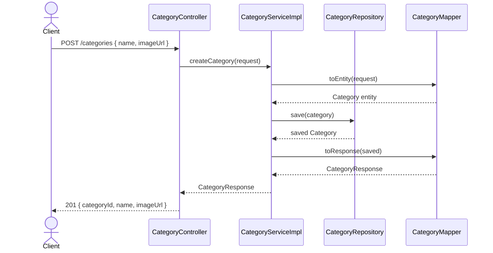

# Categories

## Огляд

CRUD-ендпоінти для управління категоріями товарів.

Операції читання — публічні.

Створення, оновлення і видалення потребують автентифікації та ролі `ADMIN`.

## Entity

```java
Category {
    id       Long    // auto-generated
    name     String  // max 256 символів, обов'язкове
    imageUrl String  // max 2048 символів, обов'язкове
}
```

Таблиця БД: `categories`

```sql
CREATE TABLE categories (
    category_id BIGINT GENERATED ALWAYS AS IDENTITY PRIMARY KEY,
    name        VARCHAR(256) NOT NULL
);

-- Додано пізніше міграцією V18
ALTER TABLE categories ADD COLUMN image_url VARCHAR(2048);
```

> `imageUrl` передається як готовий URL рядком у тілі запиту (`CategoryRequest`) — окремого ендпоінту завантаження зображення категорії немає. Для завантаження файлу зображення товару використовується `POST /products/upload-image` (Cloudinary), а отриманий URL потім вручну підставляється у `CategoryRequest.imageUrl`.

## Ендпоінти

| Метод | Ендпоінт | Опис | Авторизація |
|---|---|---|---|
| GET | `/categories` | Отримати всі категорії (сторінка) | Публічний |
| GET | `/categories/{id}` | Отримати категорію за ID | Публічний |
| POST | `/categories` | Створити категорію | ADMIN |
| PUT | `/categories/{id}` | Оновити категорію | ADMIN |
| DELETE | `/categories/{id}` | Видалити категорію | ADMIN |

---

### GET `/categories` — отримати всі категорії

Повертає категорії зі сторінковою пагінацією.

Розмір сторінки за замовчуванням: `12`.

Сортування за замовчуванням: `id`.

Приклад:

```text
GET /categories?page=0&size=12&sort=id
```

Успішна відповідь `200`

```json
{
  "timestamp": "2026-04-26T12:00:00Z",
  "status": 200,
  "message": "Categories fetched successfully",
  "data": {
    "content": [
      {
        "categoryId": 1,
        "name": "Electronics",
        "imageUrl": "https://example.com/categories/electronics.jpg"
      }
    ],
    "totalElements": 1,
    "totalPages": 1,
    "number": 0,
    "size": 12
  }
}
```

---

### GET `/categories/{id}` — отримати категорію за ID

Path variable: `id` — ID категорії

Успішна відповідь `200`

```json
{
  "timestamp": "2026-04-26T12:00:00Z",
  "status": 200,
  "message": "Category fetched successfully",
  "data": {
    "categoryId": 1,
    "name": "Electronics",
    "imageUrl": "https://example.com/categories/electronics.jpg"
  }
}
```

Помилка `404`

```json
{
  "timestamp": "2026-04-26T12:00:00Z",
  "status": 404,
  "message": "Category not found, id=1",
  "data": null
}
```

---

### POST `/categories` — створити категорію

Потребує автентифікації з роллю `ADMIN`.

Тіло запиту:

```json
{
  "name": "Electronics",
  "imageUrl": "https://example.com/categories/electronics.jpg"
}
```

| Поле | Обов'язкове | Валідація |
|---|---|---|
| `name` | Так | не порожнє, максимум 256 символів |
| `imageUrl` | Так | не порожнє, максимум 2048 символів |

Успішна відповідь `201`

```json
{
  "timestamp": "2026-04-26T12:00:00Z",
  "status": 201,
  "message": "Category created",
  "data": {
    "categoryId": 1,
    "name": "Electronics",
    "imageUrl": "https://example.com/categories/electronics.jpg"
  }
}
```

Помилка `400` — провалилась валідація запиту (наприклад, `name` або `imageUrl` порожні чи надто довгі).

Помилка `401` — відсутня автентифікація.

Помилка `403` — автентифікований користувач не має ролі `ADMIN`.

Помилка `409` — категорія з такою назвою вже існує.

Приклад:

```json
{
  "timestamp": "2026-04-26T12:00:00Z",
  "status": 409,
  "message": "Category already exists, name=Electronics",
  "data": null
}
```

Перевірка дублікатів назви — **регістронезалежна**.

---

### PUT `/categories/{id}` — оновити категорію

Потребує автентифікації з роллю `ADMIN`.

Path variable: `id` — ID категорії

Тіло запиту:

```json
{
  "name": "Home Appliances",
  "imageUrl": "https://example.com/categories/home-appliances.jpg"
}
```

| Поле | Обов'язкове | Валідація |
|---|---|---|
| `name` | Так | не порожнє, максимум 256 символів |
| `imageUrl` | Так | не порожнє, максимум 2048 символів |

Успішна відповідь `200`

```json
{
  "timestamp": "2026-04-26T12:00:00Z",
  "status": 200,
  "message": "Category updated",
  "data": {
    "categoryId": 1,
    "name": "Home Appliances",
    "imageUrl": "https://example.com/categories/home-appliances.jpg"
  }
}
```

Помилка `400` — провалилась валідація запиту.

Помилка `401` — відсутня автентифікація.

Помилка `403` — автентифікований користувач не має ролі `ADMIN`.

Помилка `404`

```json
{
  "timestamp": "2026-04-26T12:00:00Z",
  "status": 404,
  "message": "Category not found, id=1",
  "data": null
}
```

Помилка `409` — інша категорія з такою назвою вже існує.

Перевірка дублікатів назви — регістронезалежна.

Оновлення категорії без зміни назви дозволене.

---

### DELETE `/categories/{id}` — видалити категорію

Потребує автентифікації з роллю `ADMIN`.

Path variable: `id` — ID категорії

Успішна відповідь `200`

```json
{
  "timestamp": "2026-04-26T12:00:00Z",
  "status": 200,
  "message": "Category deleted successfully",
  "data": null
}
```

Помилка `401` — відсутня автентифікація.

Помилка `403` — автентифікований користувач не має ролі `ADMIN`.

Помилка `404`

```json
{
  "timestamp": "2026-04-26T12:00:00Z",
  "status": 404,
  "message": "Category not found, id=1",
  "data": null
}
```

Помилка `409` — категорія використовується існуючими товарами і не може бути видалена:

```json
{
  "timestamp": "2026-04-26T12:00:00Z",
  "status": 409,
  "message": "Category cannot be deleted because it is currently in use, id=1",
  "data": null
}
```

---

## Авторизація

Публічні ендпоінти:

```text
GET /categories
GET /categories/{id}
```

Ендпоінти лише для ADMIN:

```text
POST /categories
PUT /categories/{id}
DELETE /categories/{id}
```

Авторизація на рівні методу забезпечується через:

```java
@PreAuthorize("hasRole('ADMIN')")
```

Method security увімкнено через:

```java
@EnableMethodSecurity
```

Захищені ендпоінти використовують cookie-based автентифікацію.

`@SecurityRequirement(name = "Cookie-based Authentication")` документує вимоги до автентифікації в OpenAPI. Сам контроль доступу забезпечується Spring Security та `@PreAuthorize`.

---

## Flow



## Ключові компоненти

### `CategoryMapper`

MapStruct-мапер, що конвертує між `CategoryRequest`, `Category` та `CategoryResponse`.

```text
CategoryRequest -> Category -> CategoryResponse
```

### `CategoryServiceImpl#getByIdOrThrow`

Приватний метод, що повторно використовується в операціях, які потребують існуючої категорії.

```java
private Category getByIdOrThrow(Long id) {
    return categoryRepository.findById(id)
            .orElseThrow(() -> new CategoryNotFoundException(id));
}
```

Якщо категорію не знайдено — кидається `CategoryNotFoundException`.

`GlobalExceptionHandler` обробляє цей виняток і повертає HTTP `404`.
