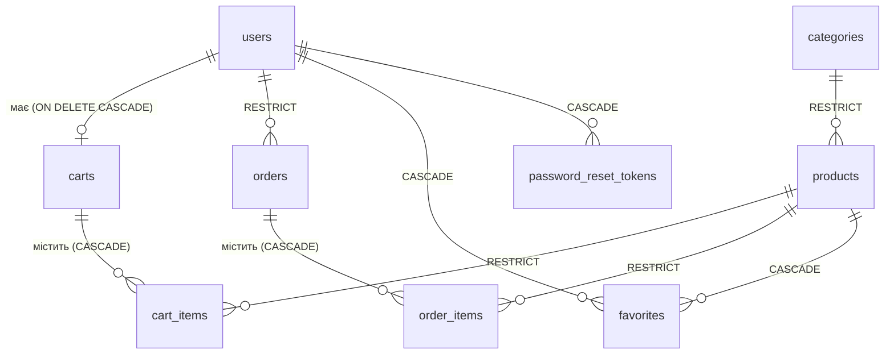

# Database

PostgreSQL, схема повністю керується **Flyway**. Hibernate схему не генерує й не змінює.

Візуальна схема таблиць: [Database_Tables_Schema.png](./Database_Tables_Schema.png).

---

## Таблиці та зв'язки

| Таблиця | Ключові обмеження |
|---|---|
| `categories` | `category_id` PK, `name` до 256, `image_url` до 2048 (nullable у БД, але обов'язковий у `CategoryRequest`) |
| `products` | `price` / `discount_price` — `DECIMAL(10,2)`, `discount_price` nullable; FK на `categories` з `ON DELETE RESTRICT` |
| `users` | `email` `UNIQUE`; `role` `CHECK IN ('USER','ADMIN')`; `phone_number` nullable |
| `carts` | `user_id` `UNIQUE` — один кошик на користувача |
| `cart_items` | `quantity > 0`; `UNIQUE (cart_id, product_id)` |
| `orders` | `status` `CHECK IN ('PENDING','PAID','SHIPPED','DELIVERED','CANCELLED')` (V13 додав `DELIVERED`); `total_price` `DECIMAL(10,2)` |
| `order_items` | `quantity > 0`; `UNIQUE (order_id, product_id)`; `price_at_purchase` — знімок ціни |
| `favorites` | складений PK `(user_id, product_id)` |
| `password_reset_tokens` | `token` `UNIQUE`, `expires_at`, `used` |

### Наслідки `ON DELETE` для API

- **Категорія** з товарами не видаляється → `409` (`CategoryDeletionException`).
- **Товар**, що є в кошику або в замовленні, не видаляється → `409` (`ProductDeletionException`). Записи у вибраному видаляються каскадно.
- **Користувач** (`DELETE /users/current-user`): кошик, вибране та reset-токени видаляються каскадно. Якщо в користувача є **замовлення**, `orders.user_id ON DELETE RESTRICT` блокує видалення; окремого обробника для цього випадку немає, тому API повертає `500 Internal server error`.

---

## Flyway-міграції

Розташування: `src/main/resources/db/migration`. Міграції виконуються **автоматично під час старту застосунку** (Spring Boot Flyway auto-configuration) — окремого кроку міграції у CI/CD немає. Під час деплою (Render, див. [CD](../ci-cd/github-cd.md)) нові міграції застосовуються, коли стартує новий контейнер.

| Версії | Призначення |
|---|---|
| V1–V8 | Схема: `categories`, `products`, `users`, `carts`, `cart_items`, `orders`, `order_items`, `favorites` |
| V9 | Створення адміністратора за замовчуванням (`admin@verdora.com`, роль `ADMIN`) |
| V10 | Таблиця `password_reset_tokens` |
| V11, V12 | **Відсутні** в основному наборі — ці номери зайняті тестовими даними (див. нижче) |
| V13 | Додає статус `DELIVERED` до `CHECK` на `orders.status` |
| V14–V17 | Оновлення пароля адміністратора (V16 — порожня міграція) |
| V18 | Колонка `categories.image_url` |
| V19–V24 | Showcase-дані магазину (див. нижче) |

> Пароль адміністратора в документації навмисно не наводиться. Актуальні облікові дані слід отримувати у відповідальних за середовище, а в продакшені — змінити пароль після першого входу.

---

## Showcase-дані (V19–V24)

Синтетичні «реалістичні» дані для демонстрації вітрини. Це **звичайні продакшн-міграції** — вони застосовуються на будь-якій базі, яка проходить Flyway (локальна, Docker, Render).

| Міграція | Дані |
|---|---|
| `V19__seed_store_categories.sql` | 15 категорій (Смартфони, Ноутбуки, Монітори, …) із зображеннями |
| `V20__seed_store_products.sql` | 20 товарів з цінами в UAH; частина має `discount_price`, частина — `NULL` |
| `V21__seed_store_customers.sql` | 18 вигаданих покупців (роль `USER`) з email на домені `@verdora.example` |
| `V22__seed_store_carts.sql` | Кошики для всіх 18 покупців і 20 позицій у кошиках (частина кошиків порожня) |
| `V23__seed_store_orders.sql` | 16 історичних замовлень у статусах `PENDING`, `PAID`, `SHIPPED`, `DELIVERED`, `CANCELLED` + 20 позицій; `total_price` перераховується з позицій |
| `V24__seed_store_favorites.sql` | 20 записів у вибраному |

Особливості:

- **Ідемпотентні вставки.** Кожен `INSERT` захищений `WHERE NOT EXISTS` (категорії/товари — за назвою, користувачі — за email, замовлення — за `user_id + created_at` тощо), тому міграції не перезаписують і не дублюють наявні дані.
- **Зв'язки за природними ключами.** Товари прив'язуються до категорій за назвою, кошики/замовлення/вибране — за email і точною назвою товару, а не за жорстко заданими ID.
- **`price_at_purchase`** у seed-замовленнях — історичні знімки ціни, які можуть відрізнятися від поточних `price`/`discount_price`.
- **Входу під seed-покупцями немає.** Кожен має випадковий bcrypt-хеш без відомого пароля.
- Адміністратор і реальні користувачі не змінюються.
- Seed-замовлення впливають на `GET /products/product-of-the-day` та звіти `/reports/*`, оскільки ті рахуються з `order_items`.

---

## Дані для інтеграційних тестів

Інтеграційні тести (`BaseIntegrationTest`, профіль `test`) працюють **не з PostgreSQL**, а з in-memory **H2** у режимі `MODE=PostgreSQL` (`src/test/resources/application-test.yaml`).

| | Застосунок | Інтеграційні тести |
|---|---|---|
| БД | PostgreSQL | H2 in-memory (`MODE=PostgreSQL`) |
| Локації Flyway | `db/migration` | `db/migration` + `db/testdata` |
| Версії | усі (V1–V24) | лише до **V18** (`spring.flyway.target: '18'`) |
| Seed-дані | V19–V24 (showcase) | `V11__insert_test_users.sql`, `V12__insert_test_data.sql` |

Тобто showcase-міграції V19–V24 у тестах **не застосовуються**, а тестові V11/V12 **ніколи не потрапляють** у продакшн (вони лежать у `src/test/resources/db/testdata`). Звідси «пропуск» V11/V12 в основному наборі міграцій.

> `VerdoraBackendApplicationTests` (`@SpringBootTest` без профілю `test`) піднімає повний контекст на реальному datasource з env-змінних — у CI для цього запускається сервіс PostgreSQL (див. [CI](../ci-cd/github-ci.md)).
