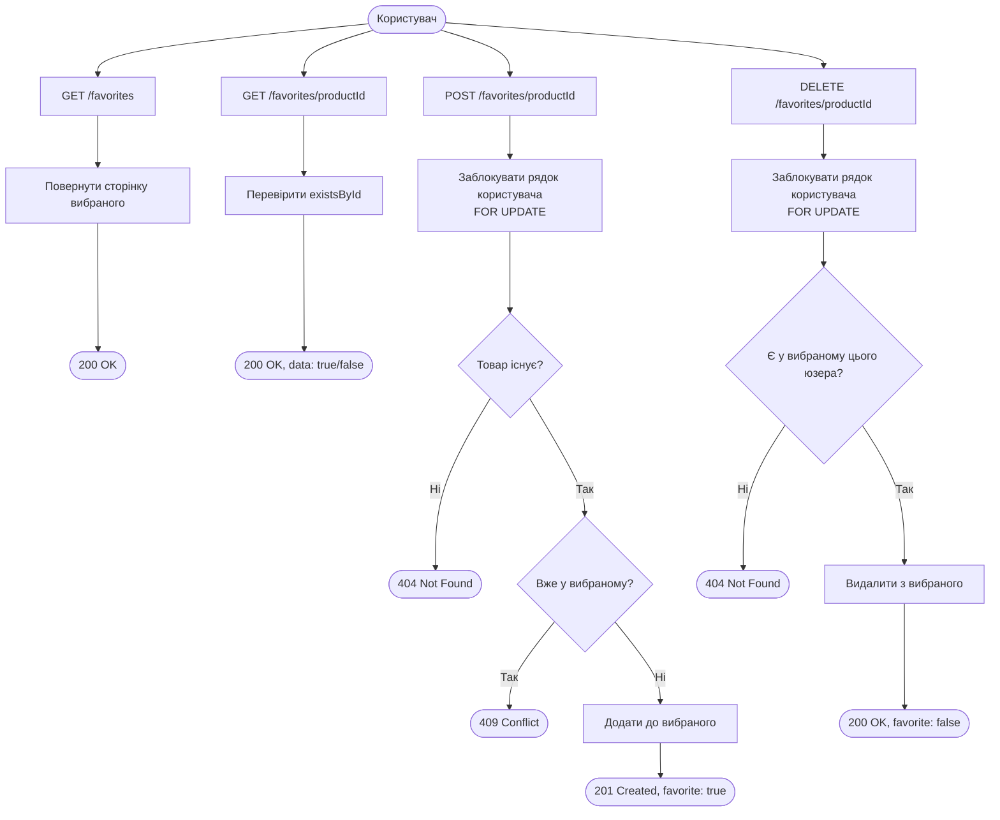
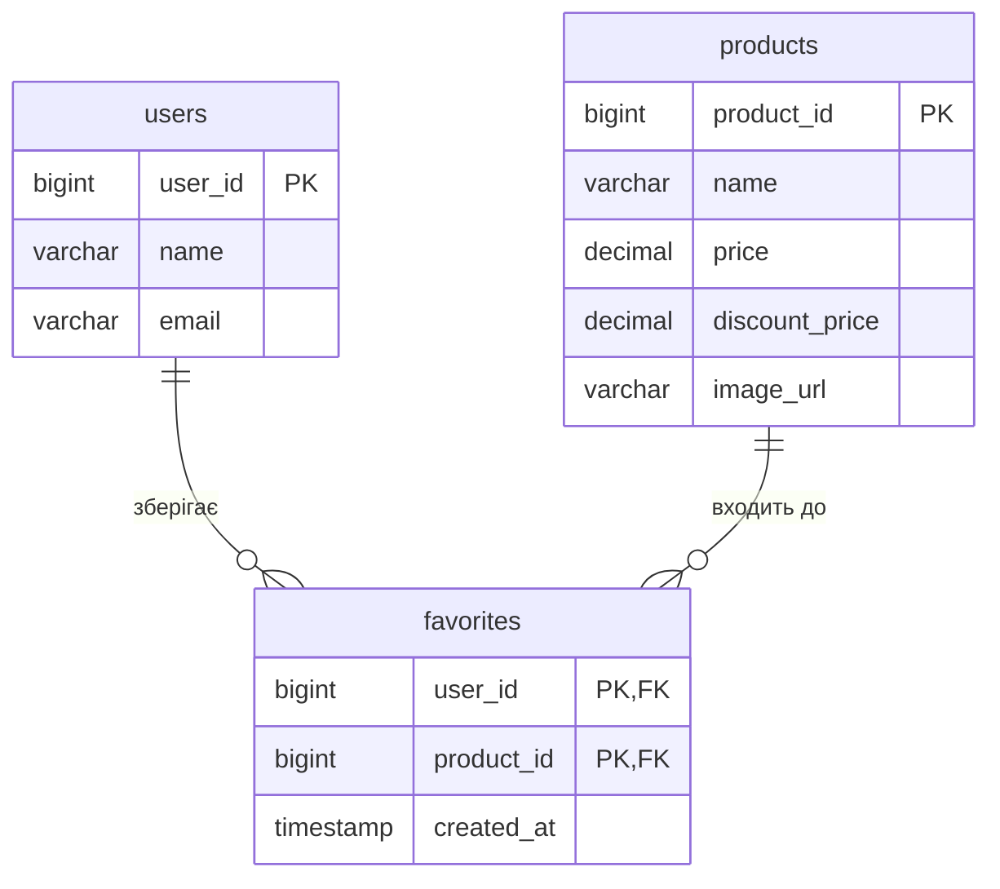

# Favorites API

Вибране — список товарів, які користувач зберіг для себе. Реалізовано через зв'язок many-to-many між `users` і `products` з composite primary key `(user_id, product_id)`.

---

## Ендпоінти

| Метод | URL | Опис |
|---|---|---|
| GET | `/favorites` | Сторінка вибраного поточного користувача |
| GET | `/favorites/{productId}` | Перевірити, чи товар у вибраному |
| POST | `/favorites/{productId}` | Додати в обране |
| DELETE | `/favorites/{productId}` | Видалити з обраного |

Всі ендпоінти потребують автентифікації (`accessToken` cookie) і завжди працюють лише з вибраним **поточного** користувача (`userId` береться з `UserPrincipal`, не з запиту) — побачити чи змінити чуже вибране неможливо.

> **Консистентність з каталогом товарів (TEAM-777):** `GET /products` і `GET /products/{id}` повертають поле `isFavorite` в `ProductResponse` — прапорець того, чи товар у вибраному поточного користувача. Для неавторизованого користувача `isFavorite` завжди `false`. Це дозволяє FE показувати стан "серця" на картці товару без додаткового запиту до `/favorites/{productId}` для кожного товару зі списку.

---

## GET /favorites

Повертає **сторінку** обраних товарів поточного користувача.

**Параметри:** `page` — номер сторінки з 0 (default `0`); `size` — кількість товарів на сторінці (default і максимум — `12`).

Контролер (`FavoriteController`) обмежує розмір сторінки через `Math.min(pageable.getPageSize(), 12)`, тобто `size` понад `12` **мовчки обрізається до 12**, а не повертає помилку. Від'ємний `page` або `size = 0` теж **не викликають 400** — Spring Data `Pageable`-резолвер підставляє значення за замовчуванням (`page=0`, `size=12`). Це підтверджено інтеграційними тестами (`getFavorites_invalidPagination_usesDefaults`, `getFavorites_pageSizeAboveLimit_isCapped`).

Сортування за замовчуванням: `createdAt` **DESC** (найновіші додані — першими). Кастомне сортування через `sort` можна передати як звичайний параметр пагінації Spring Data.

**Response 200:**

Ендпоінт повертає стандартну серіалізацію Spring Data `Page<FavoriteResponse>` (контролер не оборгортає її в кастомний DTO), тому в `data` присутні всі поля `PageImpl`, а не лише `content`/`totalElements`:

```json
{
  "timestamp": "2026-05-23T12:00:00Z",
  "status": 200,
  "message": "Favorites fetched successfully",
  "data": {
    "content": [
      {
        "productId": 1,
        "productName": "Ноутбук ASUS VivoBook 15",
        "imageUrl": "https://example.com/laptop.jpg",
        "price": 32999.99,
        "discountPrice": 27999.99,
        "addedAt": "2026-05-20T10:00:00Z"
      }
    ],
    "pageable": {
      "pageNumber": 0,
      "pageSize": 12,
      "sort": { "sorted": true, "unsorted": false, "empty": false },
      "offset": 0,
      "paged": true,
      "unpaged": false
    },
    "last": true,
    "totalPages": 1,
    "totalElements": 1,
    "size": 12,
    "number": 0,
    "sort": { "sorted": true, "unsorted": false, "empty": false },
    "first": true,
    "numberOfElements": 1,
    "empty": false
  }
}
```

Якщо вибраного немає: `200 OK`, `data.content: []`, `data.empty: true`, `data.totalElements: 0`, `data.totalPages: 0`.

На FE для наступної сторінки — запитують `page + 1` з тим самим `size`, доки `data.last` не стане `true`.

**Важливо:** `price` — звичайна ціна товару, `discountPrice` — акційна ціна (nullable). Фактична вартість — `discountPrice`, якщо вона менша за `price` (аналогічно `Product#getEffectivePrice()`), інакше — `price`. Це має збігатися з FE-контрактом і мапінгом `FavoriteMapper`.

**Response 401** — відсутня або недійсна автентифікація.

---

## GET /favorites/{productId}

Перевіряє, чи товар `productId` знаходиться у вибраному поточного користувача. Не кидає 404, якщо товару взагалі не існує — просто повертає `false`.

**Response 200:**
```json
{
  "status": 200,
  "message": "Favorite status fetched",
  "data": true
}
```

`data` — примітивний `boolean` (`true`/`false`), не об'єкт.

---

## POST /favorites/{productId}

Додає товар до вибраного. Повертає **стан вибраного після додавання** (`FavoriteStateResponse`), а не повну картку товару.

**Response 201:**
```json
{
  "status": 201,
  "message": "Added to favorites",
  "data": {
    "productId": 5,
    "favorite": true
  }
}
```

**Response 404** — товар не знайдено:
```json
{
  "status": 404,
  "message": "Product not found, id=99"
}
```

**Response 409** — товар вже у вибраному:
```json
{
  "status": 409,
  "message": "Product already in favorites, productId=5"
}
```

**Response 400** — `productId` у шляху не є числом (наприклад `/favorites/abc`).

**Response 401** — потрібна автентифікація.

---

## DELETE /favorites/{productId}

Видаляє товар з вибраного. Повертає **стан вибраного після видалення** (`FavoriteStateResponse`).

**Response 200:**
```json
{
  "status": 200,
  "message": "Removed from favorites",
  "data": {
    "productId": 5,
    "favorite": false
  }
}
```

**Response 404** — товару немає у вибраному поточного користувача (або чужий запис — див. "Бізнес-логіка" нижче):
```json
{
  "status": 404,
  "message": "Product not found in favorites, productId=99"
}
```

**Response 400** — `productId` у шляху не є числом.

**Response 401** — потрібна автентифікація.

---

## Структура відповіді

### FavoriteResponse (елемент `GET /favorites`)
| Поле | Тип | Опис |
|---|---|---|
| `productId` | Long | ID товару |
| `productName` | String | Назва товару |
| `imageUrl` | String | URL зображення |
| `price` | BigDecimal | Звичайна ціна (до знижки) |
| `discountPrice` | BigDecimal, nullable | Акційна ціна, якщо вона є |
| `addedAt` | OffsetDateTime | Дата додавання в обране (`created_at` з БД) |

### FavoriteStateResponse (результат `POST`/`DELETE`)
| Поле | Тип | Опис |
|---|---|---|
| `productId` | Long | ID товару |
| `favorite` | boolean | `true` після додавання, `false` після видалення |

---

## Бізнес-логіка

- Один юзер не може додати один і той самий товар двічі — `POST` повертає **409 CONFLICT**.
- Видалення неіснуючого запису у вибраному — `DELETE` повертає **404 NOT FOUND**. Це стосується і спроби видалити товар, який є у вибраному **іншого** користувача: оскільки перевірка йде по composite key `(userId, productId)` поточного користувача, чужий favorite для нього виглядає як відсутній → теж 404 (user isolation перевірено тестом `removeFavorite_anotherUsersFavorite_returns404`).
- Composite PK `(user_id, product_id)` у таблиці `favorites` гарантує унікальність на рівні БД — повторна вставка того самого `(userId, productId)` неможлива навіть за гонки запитів.
- **Блокування при паралельних запитах:** `addFavorite`/`removeFavorite` спершу виконують `userRepository.findByIdForUpdate(userId)` — запит з `@Lock(LockModeType.PESSIMISTIC_WRITE)`, що бере пісимістичне блокування на рядок користувача в `users`. Це серіалізує паралельні add/remove-запити одного й того ж користувача (наприклад, два швидкі кліки по "серцю" з різних вкладок) і запобігає гонці "exists-check → insert", яка інакше могла б призвести до спроби вставити дублікат між перевіркою `existsById` і `save`.
- При видаленні юзера або товару — відповідний запис у `favorites` видаляється автоматично (`ON DELETE CASCADE` на обох FK).
- `isFavorite` у `ProductResponse` (ендпоінти `/products` і `/products/{id}`) обчислюється через той самий `FavoriteRepository` і завжди відображає стан вибраного **поточного автентифікованого користувача**; для гостя — завжди `false`.

---

## Діаграма флоу



---

## Діаграма БД


