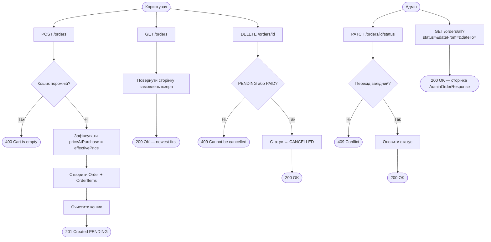
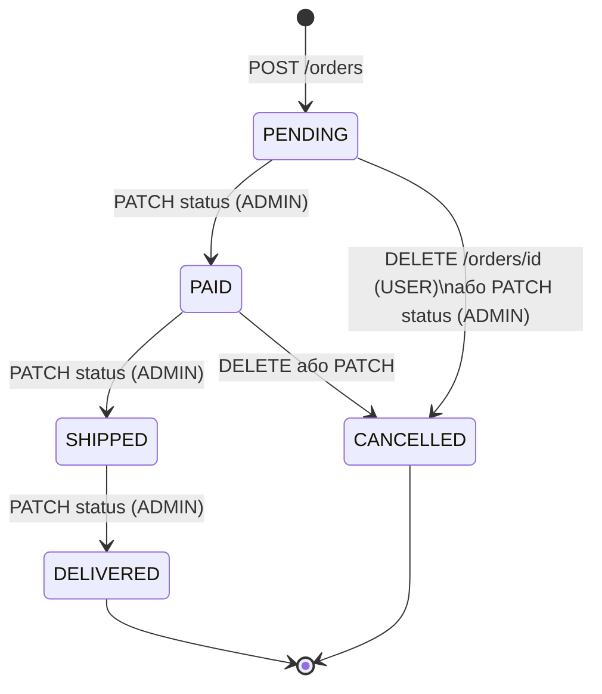
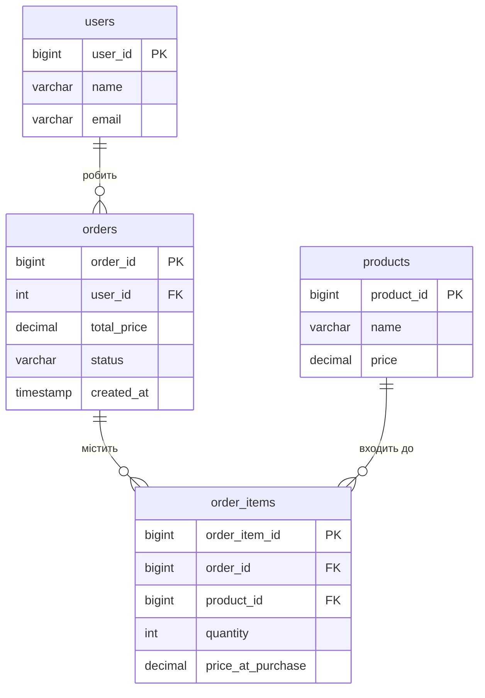

# Orders API

Замовлення створюється з поточного кошика. Ціни фіксуються на момент оформлення. Після успішного замовлення кошик очищається.

---

## Статуси замовлення

| Статус | Опис |
|---|---|
| `PENDING` | Очікує оплати |
| `PAID` | Підтверджено |
| `SHIPPED` | В дорозі |
| `DELIVERED` | Доставлено |
| `CANCELLED` | Скасовано |

Backend повертає технічні enum-значення, а user-facing labels формуються на FE.

Дозволені переходи (`OrderStatus#canTransitionTo`): `PENDING → PAID`, `PENDING → CANCELLED`, `PAID → SHIPPED`, `PAID → CANCELLED`, `SHIPPED → DELIVERED`. `DELIVERED` і `CANCELLED` — фінальні статуси (`OrderStatus#isFinal`), з них перехід неможливий у жодному напрямку.

---

## Ендпоінти

| Метод | URL | Роль | Опис |
|---|---|---|---|
| POST | `/orders` | USER | Оформити замовлення з кошика |
| GET | `/orders` | USER | Сторінка власних замовлень |
| GET | `/orders/{orderId}` | USER | Деталі свого замовлення |
| GET | `/orders/{orderId}/status` | USER | Легкий опитувальний (polling) статус свого замовлення |
| DELETE | `/orders/{orderId}` | USER | Скасувати своє замовлення |
| GET | `/orders/all` | ADMIN | Сторінка всіх замовлень з фільтрами |
| GET | `/orders/{orderId}/details` | ADMIN | Повні деталі будь-якого замовлення (з даними покупця) |
| PATCH | `/orders/{orderId}/status` | ADMIN | Змінити статус замовлення |

Всі ендпоінти потребують автентифікації (`accessToken` cookie).

---

## POST /orders

Оформлює замовлення з поточного кошика. Кошик очищається після успішного створення.

**Response 201:**
```json
{
  "timestamp": "2026-05-23T12:00:00Z",
  "status": 201,
  "message": "Order placed successfully",
  "data": {
    "orderId": 1,
    "createdAt": "2026-05-23T12:00:00Z",
    "totalPrice": 45498.99,
    "status": "PENDING",
    "items": [
      {
        "orderItemId": 1,
        "productId": 1,
        "productName": "Ноутбук ASUS VivoBook 15",
        "imageUrl": "https://example.com/laptop.jpg",
        "categoryName": "Електроніка",
        "quantity": 1,
        "priceAtPurchase": 32999.99,
        "subtotal": 32999.99
      },
      {
        "orderItemId": 2,
        "productId": 2,
        "productName": "Навушники Sony WH-1000XM5",
        "imageUrl": "https://example.com/headphones.jpg",
        "categoryName": "Електроніка",
        "quantity": 1,
        "priceAtPurchase": 12499.00,
        "subtotal": 12499.00
      }
    ]
  }
}
```

**Response 400** — кошик порожній (також якщо у юзера ще немає кошика взагалі):
```json
{
  "status": 400,
  "message": "Cannot place order: cart is empty"
}
```

---

## GET /orders

Повертає **сторінку** замовлень поточного користувача.

**Параметри пагінації:** `page` (default `0`), `size` (default і максимум `12`, більші значення обрізаються через `Math.min(size, 12)` — аналогічно `GET /favorites`). Сортування за замовчуванням: `createdAt` **DESC**.

**Response 200** — стандартна Spring Data `Page<OrderResponse>` (поля `content`, `number`, `size`, `totalElements`, `totalPages`, `last` тощо — див. приклад структури сторінки в [favorites.md](../favorites/favorites.md)); елементи `content` мають структуру як у `POST /orders`.

---

## GET /orders/{orderId}

Повертає конкретне замовлення. Юзер може бачити тільки свої замовлення — чужий `orderId` повертає 404 (пошук виконується через `findByIdAndUser_Id`).

**Response 200** — замовлення (структура як у `POST /orders`).

**Response 404** — замовлення не знайдено або належить іншому користувачу:
```json
{
  "status": 404,
  "message": "Order not found, id=99"
}
```

---

## GET /orders/{orderId}/status

Легкий ендпоінт для періодичного опитування статусу (наприклад, для сторінки "Відстеження замовлення" на FE), не вантажить список товарів.

**Response 200:**
```json
{
  "status": 200,
  "message": "Order status fetched successfully",
  "data": {
    "orderId": 15,
    "status": "SHIPPED",
    "finalStatus": false
  }
}
```

`finalStatus` — `true`, коли `status` є `DELIVERED` або `CANCELLED`.

**Response 404** — замовлення не знайдено або належить іншому користувачу.

---

## DELETE /orders/{orderId}

Скасовує замовлення. Можливо тільки якщо статус `PENDING` або `PAID` (тобто `canTransitionTo(CANCELLED) == true`).

**Response 200** — повертає оновлене замовлення зі статусом `CANCELLED`.

**Response 404** — замовлення не знайдено або належить іншому користувачу.

**Response 409** — замовлення не можна скасувати. Повідомлення залежить від поточного статусу:
```json
{
  "status": 409,
  "message": "Order cannot be cancelled, id=1. Current status: SHIPPED. Only PENDING and PAID orders can be cancelled"
}
```
Якщо замовлення вже `CANCELLED`:
```json
{
  "status": 409,
  "message": "Order is already cancelled, id=1"
}
```

---

## GET /orders/all (ADMIN)

Повертає сторінку **всіх** замовлень усіх користувачів з опціональними фільтрами.

**Параметри:**

| Параметр | Тип | Опис |
|---|---|---|
| `status` | OrderStatus | Фільтр за статусом (`PENDING`, `PAID`, `SHIPPED`, `DELIVERED`, `CANCELLED`) |
| `dateFrom` | LocalDate | Нижня межа дати створення (включно) |
| `dateTo` | LocalDate | Верхня межа дати створення (включно) |
| `page`, `size` | — | Пагінація, default size `12`, сортування `createdAt DESC` |

**Response 200** — `Page<AdminOrderResponse>`. На відміну від `OrderResponse`, елемент містить `customer` (`UserResponse`) замість списку товарів:
```json
{
  "orderId": 1,
  "createdAt": "2026-05-23T12:00:00Z",
  "totalPrice": 1500.00,
  "status": "PENDING",
  "customer": {
    "id": 7,
    "name": "Stepan",
    "email": "stepan@gmail.com",
    "phone": "+380989703417"
  }
}
```

**Response 403** — якщо викликано не ADMIN.

---

## GET /orders/{orderId}/details (ADMIN)

Повертає повні деталі **будь-якого** замовлення (без обмеження по користувачу) — об'єднує дані `AdminOrderResponse` (`customer`) та список `items` з `OrderResponse`.

**Response 200:**
```json
{
  "orderId": 1,
  "createdAt": "2026-05-23T12:00:00Z",
  "totalPrice": 1500.00,
  "status": "PENDING",
  "customer": {
    "id": 7,
    "name": "Stepan",
    "email": "stepan@gmail.com",
    "phone": "+380989703417"
  },
  "items": [
    {
      "orderItemId": 1,
      "productId": 1,
      "productName": "Laptop",
      "imageUrl": "https://example.com/laptop.jpg",
      "categoryName": "Electronics",
      "quantity": 1,
      "priceAtPurchase": 1500.00,
      "subtotal": 1500.00
    }
  ]
}
```

**Response 404** — замовлення не знайдено. **Response 403** — якщо викликано не ADMIN.

---

## PATCH /orders/{orderId}/status (ADMIN)

Змінює статус замовлення за правилами `OrderStatus#canTransitionTo`.

**Request body:**
```json
{
  "status": "SHIPPED"
}
```

**Допустимі значення:** `PENDING`, `PAID`, `SHIPPED`, `DELIVERED`, `CANCELLED`.

**Response 200** — повертає оновлене замовлення (структура як у `POST /orders`).

**Response 400** — тіло запиту відсутнє/невалідне або вказано неіснуюче значення enum.

**Response 403** — якщо не ADMIN.

**Response 404** — замовлення не знайдено.

**Response 409** — недопустимий перехід статусу:
```json
{
  "status": 409,
  "message": "Invalid order status transition: PENDING -> SHIPPED"
}
```

---

## Структура відповіді

### OrderResponse
| Поле | Тип | Опис |
|---|---|---|
| `orderId` | Long | ID замовлення |
| `createdAt` | OffsetDateTime | Дата створення |
| `totalPrice` | BigDecimal | Загальна сума |
| `status` | OrderStatus | Статус |
| `items` | List\<OrderItemResponse\> | Список товарів |

### OrderItemResponse
| Поле | Тип | Опис |
|---|---|---|
| `orderItemId` | Long | ID елемента замовлення |
| `productId` | Long | ID товару |
| `productName` | String | Назва товару на момент покупки |
| `imageUrl` | String | URL зображення товару |
| `categoryName` | String | Назва категорії товару |
| `quantity` | Integer | Кількість |
| `priceAtPurchase` | BigDecimal | Ціна за одиницю на момент покупки |
| `subtotal` | BigDecimal | `priceAtPurchase × quantity` |

### AdminOrderResponse (ADMIN, `GET /orders/all`)
| Поле | Тип | Опис |
|---|---|---|
| `orderId` | Long | ID замовлення |
| `createdAt` | OffsetDateTime | Дата створення |
| `totalPrice` | BigDecimal | Загальна сума |
| `status` | OrderStatus | Статус |
| `customer` | UserResponse | Дані покупця (`id`, `name`, `email`, `phone`) |

### AdminOrderDetailsResponse (ADMIN, `GET /orders/{orderId}/details`)
Те саме, що `AdminOrderResponse`, плюс поле `items` (`List<OrderItemResponse>`).

### OrderStatusResponse (`GET /orders/{orderId}/status`)
| Поле | Тип | Опис |
|---|---|---|
| `orderId` | Long | ID замовлення |
| `status` | OrderStatus | Поточний статус |
| `finalStatus` | boolean | `true`, якщо статус фінальний (`DELIVERED`/`CANCELLED`) |

---

## Бізнес-логіка

- `priceAtPurchase` фіксується на момент оформлення як **ефективна ціна товару** (`Product#getEffectivePrice()`) — тобто `discountPrice`, якщо вона менша за `price`, інакше звичайна `price`. Якщо ціна товару зміниться пізніше — це не вплине на вже оформлене замовлення.
- Після `POST /orders` кошик **очищається автоматично**, і сам `Cart` не видаляється — лише його елементи.
- Юзер бачить **тільки свої** замовлення через `GET /orders`, `/orders/{orderId}`, `/orders/{orderId}/status` — чужий `orderId` повертає 404. Повний огляд усіх замовлень доступний лише ADMIN через `/orders/all` і `/orders/{orderId}/details`.
- Скасувати (`DELETE`) можна лише `PENDING` або `PAID` замовлення; `SHIPPED`/`DELIVERED` повертають 409, уже `CANCELLED` — також 409 з іншим повідомленням.
- `PATCH /orders/{orderId}/status` (ADMIN) не має обмеження по користувачу і дозволяє лише переходи, описані в `OrderStatus#canTransitionTo` — усі інші повертають 409.
- Список замовлень (`GET /orders`, `GET /orders/all`) відсортований **від найновіших** (`createdAt DESC`) за замовчуванням.

---

## Діаграма флоу



## Діаграма статусів замовлення



## Діаграма БД


