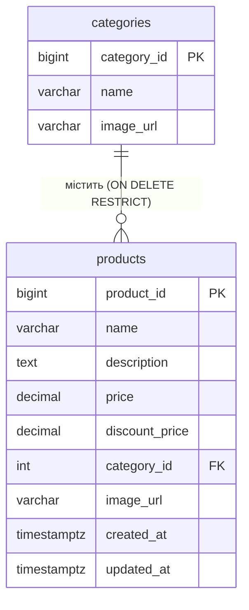

# Products API

Каталог товарів: публічне читання (з фільтрами, пошуком, сортуванням і пагінацією), CRUD та завантаження зображень — лише для `ADMIN`.

---

## Ендпоінти

| Метод | URL | Авторизація | Опис |
|---|---|---|---|
| GET | `/products` | Публічний | Сторінка товарів з фільтрами, пошуком і сортуванням |
| GET | `/products/{id}` | Публічний | Товар за ID |
| GET | `/products/product-of-the-day` | Публічний | Найбільш продаваний товар («товар дня») |
| POST | `/products` | ADMIN | Створити товар |
| PUT | `/products/{id}` | ADMIN | Оновити товар (повна заміна полів) |
| DELETE | `/products/{id}` | ADMIN | Видалити товар |
| POST | `/products/upload-image` | ADMIN | Завантажити зображення товару в Cloudinary |

Публічність `GET /products/**` задається у `SecurityConfig` (`permitAll` для `HttpMethod.GET`). Для решти методів потрібен валідний `accessToken` cookie, а `@PreAuthorize("hasRole('ADMIN')")` перевіряє роль: без автентифікації — `401`, з роллю `USER` — `403`.

---

## Ефективна ціна

Товар має звичайну ціну `price` і опціональну акційну `discountPrice`. **Ефективна ціна** — це ціна, яку реально платить покупець:

```
effectivePrice = discountPrice, якщо discountPrice != null AND discountPrice > 0 AND discountPrice < price
               = price,         інакше
```

Вона реалізована двічі з однаковою логікою:

- `Product#getEffectivePrice()` — у Java; використовується кошиком (`CartItemResponse.price`) і при оформленні замовлення (`OrderItem.priceAtPurchase`).
- `Product.sortPrice` — `@Formula` (SQL `CASE ... END`); використовується для фільтрів `minPrice`/`maxPrice`/`discount` та сортування за `price`.

> У `ProductResponse` окремого поля `effectivePrice` немає — повертаються `price` і `discountPrice`, а FE сам визначає, яку ціну показувати.

---

## GET /products

Повертає `Page<ProductResponse>` з опціональними фільтрами.

**Query-параметри:**

| Параметр | Тип | Опис |
|---|---|---|
| `categoryId` | Long | Лише товари цієї категорії |
| `minPrice` | BigDecimal, `>= 0` | Ефективна ціна `>= minPrice` |
| `maxPrice` | BigDecimal, `>= 0` | Ефективна ціна `<= maxPrice` |
| `discount` | Boolean | `true` — лише товари з діючою знижкою (ефективна ціна `< price`); `false` — лише товари без діючої знижки (ефективна ціна `= price`); не вказано — без фільтра |
| `search` | String | Пошук підрядка в назві, регістронезалежний (`LIKE %search%`, пробіли по краях обрізаються; порожній рядок ігнорується) |
| `page` | int | Номер сторінки з 0 (default `0`) |
| `size` | int | Розмір сторінки (default `12`; верхня межа контролером не обмежується) |
| `sort` | String | Сортування Spring Data, напр. `sort=price,asc`. Default — `id` ASC |

**Сортування за ціною.** `sort=price` (`asc`/`desc`) автоматично підміняється на сортування за ефективною ціною (`sortPrice`), тобто товар зі знижкою сортується за `discountPrice`. Якщо в сортуванні немає `id`, до нього додається `id ASC` як стабільний tie-breaker (щоб пагінація не «стрибала» між товарами з однаковою ціною). Інші поля (`name`, `createdAt`, …) сортуються як є.

> Фільтри `minPrice`/`maxPrice` не перевіряють, що `minPrice <= maxPrice` — якщо `minPrice > maxPrice`, повернеться порожня сторінка.

**Приклад:**

```
GET /products?categoryId=2&minPrice=1000&maxPrice=20000&discount=true&sort=price,asc&page=0&size=12
```

**Response 200:**

```json
{
  "timestamp": "2026-11-07T12:00:00Z",
  "status": 200,
  "message": "Products fetched successfully",
  "data": {
    "content": [
      {
        "productId": 7,
        "name": "Sony WH-1000XM5, Black",
        "description": "Бездротові повнорозмірні навушники з активним шумозаглушенням...",
        "price": 14999.00,
        "categoryId": 4,
        "imageUrl": "https://images.unsplash.com/photo-...",
        "discountPrice": 12999.00,
        "createdAt": "2026-06-14T15:00:00Z",
        "updatedAt": "2026-06-20T15:00:00Z",
        "isFavorite": false
      }
    ],
    "number": 0,
    "size": 12,
    "totalElements": 1,
    "totalPages": 1,
    "last": true
  }
}
```

**`isFavorite`:** ендпоінт публічний, але якщо запит містить валідний `accessToken`, `isFavorite` показує, чи товар у вибраному поточного користувача (один батч-запит до `favorites` на сторінку). Для анонімного запиту завжди `false`.

**Response 400** — `minPrice`/`maxPrice` від'ємні (`"minPrice cannot be less than 0"`), або параметр має невалідний тип (`"Parameter 'minPrice' must be a valid BigDecimal"`).

---

## GET /products/{id}

Повертає `ProductResponse` (з `isFavorite` для автентифікованого користувача).

**Response 404:**

```json
{
  "status": 404,
  "message": "Product not found, id=99",
  "data": null
}
```

---

## GET /products/product-of-the-day

Повертає **найбільш продаваний товар** — з найбільшою сумарною кількістю (`SUM(order_items.quantity)`) у замовленнях зі статусами `PAID`, `SHIPPED`, `DELIVERED`. Замовлення `PENDING` та `CANCELLED` не враховуються. При однаковій кількості перемагає товар з меншим `id`.

Товар визначається на кожен запит (без кешування та без прив'язки до дати) — «дня» тут лише назва для FE. Знижка на вибір не впливає.

**Response 200** — `ProductResponse` (з `isFavorite` для автентифікованого користувача).

**Response 200 з `data: null`** — якщо жодного продажу в зазначених статусах немає:

```json
{
  "status": 200,
  "message": "Product of the day fetched successfully",
  "data": null
}
```

---

## POST /products (ADMIN)

**Request body (`ProductRequest`):**

```json
{
  "name": "Laptop",
  "description": "High-performance gaming laptop with 16GB RAM",
  "price": 500,
  "categoryId": 1,
  "imageUrl": "https://site.com/image.jpg",
  "discountPrice": 300
}
```

**Валідація:**

| Поле | Обов'язкове | Правила |
|---|---|---|
| `name` | ✅ | не порожнє, до 256 символів |
| `description` | ❌ | до 1000 символів |
| `price` | ✅ | `> 0` |
| `categoryId` | ✅ | `> 0`; категорія має існувати (інакше 404) |
| `imageUrl` | ✅ | не порожнє, до 512 символів, валідний **HTTPS** URL |
| `discountPrice` | ❌ | якщо вказано: `> 0` і **строго менше** за `price` (`@ValidDiscountPrice`) |

При кількох помилках `GlobalExceptionHandler` повертає повідомлення лише **першої** з них.

**Response 201** — `ProductResponse` (`isFavorite` = `false`), `message: "Product created"`.

**Помилки:**

| Код | Причина |
|---|---|
| 400 | Помилка валідації, напр. `"Discount price must be lower than regular price"`, `"Image URL must be a valid HTTPS URL"`, або невалідний JSON (`"Malformed JSON request"`) |
| 401 | Немає автентифікації |
| 403 | Роль не `ADMIN` |
| 404 | `"Category not found, id=..."` |

---

## PUT /products/{id} (ADMIN)

Тіло і валідація — як у `POST /products`. Це **повна заміна**: усі поля з запиту записуються в товар, тому відсутній `discountPrice` (або `null`) прибирає знижку, а відсутній `description` очищає опис.

**Response 200** — оновлений `ProductResponse`, `message: "Product updated"`.

**Помилки:** 400, 401, 403 — як вище; 404 — товар або категорію не знайдено.

---

## DELETE /products/{id} (ADMIN)

**Response 200** — `message: "Product deleted successfully"`, `data: null`.

Записи у `favorites` для цього товару видаляються каскадно (`ON DELETE CASCADE`). Якщо товар є в чиємусь кошику або в будь-якому замовленні, БД блокує видалення (`ON DELETE RESTRICT`), і повертається:

```json
{
  "status": 409,
  "message": "Product cannot be deleted because it is currently in use, id=5",
  "data": null
}
```

**Інші помилки:** 401, 403, 404.

---

## POST /products/upload-image (ADMIN)

`multipart/form-data` з частиною `file`. Завантажує зображення в Cloudinary (папка `verdora/products`) і повертає URL, який потім передається як `imageUrl` у `POST`/`PUT /products`.

**Обмеження:** формати JPEG, PNG, WEBP; розмір до 5 MB (`spring.servlet.multipart.max-file-size: 5MB`).

**Response 200:**

```json
{
  "status": 200,
  "message": "Image uploaded successfully",
  "data": {
    "imageUrl": "https://res.cloudinary.com/..."
  }
}
```

**Помилки:**

| Код | Повідомлення |
|---|---|
| 400 | `"Image file is required"` / `"Image size must not exceed 5 MB"` / `"Only JPEG, PNG and WEBP images are supported"` |
| 401 / 403 | Немає автентифікації / роль не `ADMIN` |
| 500 | `"Failed to upload image"` (помилка Cloudinary) |

---

## Структура відповіді

### ProductResponse

| Поле | Тип | Опис |
|---|---|---|
| `productId` | Long | ID товару |
| `name` | String | Назва |
| `description` | String, nullable | Опис |
| `price` | BigDecimal | Звичайна ціна |
| `categoryId` | Long | ID категорії |
| `imageUrl` | String | URL зображення |
| `discountPrice` | BigDecimal, nullable | Акційна ціна |
| `createdAt` | OffsetDateTime | Дата створення (UTC) |
| `updatedAt` | OffsetDateTime | Дата останнього оновлення (UTC) |
| `isFavorite` | boolean | Чи у вибраному поточного користувача (`false` для анонімів) |

---

## Обмеження поточної реалізації

- Немає складського обліку (stock/кількості на складі) — кошик і замовлення не перевіряють наявність.
- Немає soft delete: товар, що вже потрапив у замовлення, видалити неможливо (409).
- Немає фільтрів за кількома категоріями чи за діапазоном дат; пошук — лише за назвою.

---

## Діаграма БД


